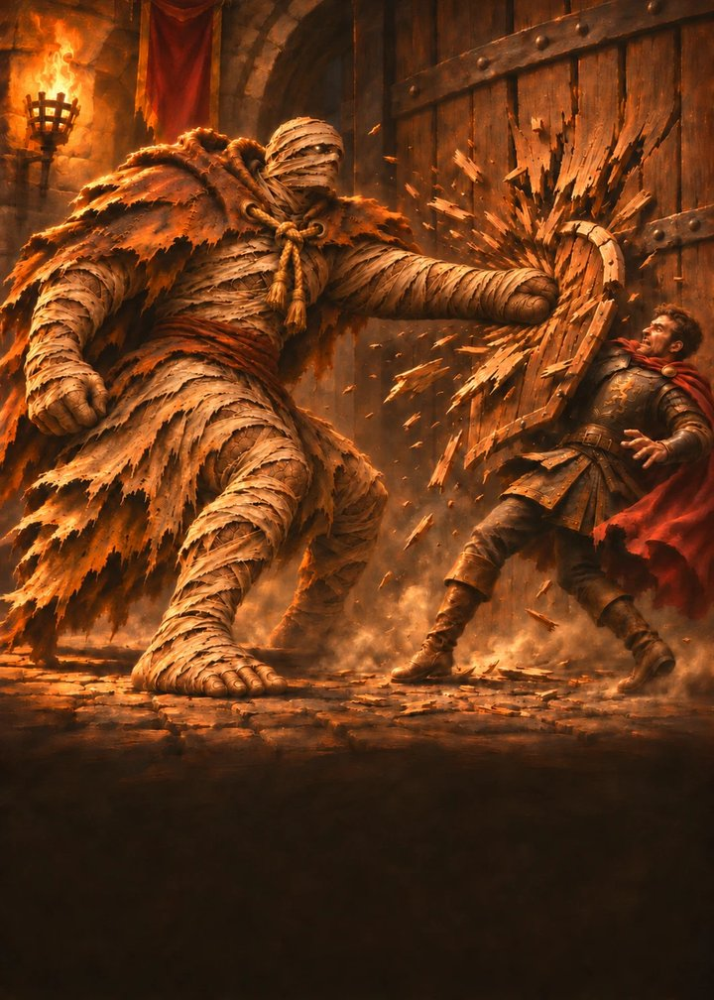

# Marrow Rite

A brutal dark-fantasy tag-team fighting card game (TCG). Every hundred years Vorhul, the Unburied, holds a tournament to choose who sits beside his throne. The losers become the throne.

Build a team of three fighters, tag between them, and play your cards like combos.

**Play it and watch the trailer:** https://ariesfulkerson.github.io/Marrow-Rite/

## The fighters

| Fighter | Title | Style | HP | Passive |
|---|---|---|---|---|
| Ashkar | The Ember Monk | Self-burn aggro | 28 | **Pyre:** his first hit each turn sets the enemy burning; builds Heat that powers his cards |
| Sable Moru | The Stitched Surgeon | Bleed attrition | 27 | **Sutures:** heals 2 each time an enemy takes Bleed damage |
| Brannoch | The Wrapped | Retaliation tank | 30 | **Grave Linen:** starts each turn with 2 Guard; enemy cards that land on his Guard take 1 damage back |
| Lady Wen | Of the Hollow | Discard engine | 24 | **Hunger:** every discard feeds her Hunger; her Specials hit harder the hungrier she is |
| Old Teeth | The Bog Mother | Traps & venom control | 28 | **Patience:** unspent Energy turns into Guard; sets hidden Traps |
| Bram Coil | The Hook | Tag control & executions | 28 | **Reel:** 3 damage whenever he tags in; a Noosed target takes extra damage from every hit |
| Harrow | The Bloomed | Bonebloom berserker | 28 | **Bonebloom:** grows Bloom every turn and hits harder for it, but the Bloom eats at his HP |
| Ninefold | The Unclaimed | Telekinetic control | 36 | **The Unclaimed:** floats over Traps; every Special adds a Soul to its strikes; Gripped enemies can't tag out or Guard |
| Vorhul | The Unburied (boss) | Tithe & drain | 40 | **Tithe:** heals 6 whenever an enemy fighter is knocked out |

147 cards in total: 13 for each of the eight fighters, 10 for Vorhul and 33 neutral. Each fighter, Vorhul included, also has an Echo card that their cards turn into when they fall.

The **Ossuary Season** expansion added 33 of those cards: three for every fighter, Vorhul included, and six neutral.

### How it plays

- **Your turn:** draw 2. Energy refills and grows each turn, from 1 up to 8.
- **Chains:** Light → Medium → Heavy. Every hit adds +1 damage to the next (up to +3); 3- and 5-hit chains earn Meter.
- **Meter (max 5):** spend it on EX versions of cards, on Finishers that close a 2-hit chain, or on a Breaker that snaps the enemy's next 3-hit chain.
- **Tag:** once a turn for 1 Energy. The chain survives the swap, and Burn, Bleed, Venom and Noose on the fighter leaving are halved.
- **The Last Rite:** when each side has one fighter left, both heal to full. With 3 Meter and the enemy at 6 HP or less, a Last Rite ends the match.

### Starter decks

- **Plague Pyre** (Sable Moru, Ashkar, Old Teeth): stack Burn, Bleed and Venom, then cash them in with Open Wounds.
- **The Gate Holds** (Brannoch, Old Teeth, Bram Coil): a wall of Guard that punishes attackers.
- **Thousand Cuts** (Bram Coil, Lady Wen, Ashkar): many small hits, each carrying chain, Noose and Bloodlust bonuses.
- **Bonebloom** (Sable Moru, Harrow, Ninefold): Sable opens the Bleed, Harrow feeds on it, Ninefold pins the wounded in place.

Balance was tuned with 100k balance-based simulations: AI-vs-AI matches with random teams and every starter deck.

## What's in this repo

| Path | What it is |
|---|---|
| `index.html` | The project site (served by GitHub Pages): fighters, cards, rules, the trailer, a pitch for studios, and play links |
| `play/` | The playable browser build: vs AI, packs, collection, deck builder. Progress saves in the browser. |
| `host/` | The Windows host app for 1v1 against friends (see `host/README.md`) |
| `marrow-rite-host.zip` | The same host app, zipped for download from the site |
| `android/` | The Android app project: the same game plus a built-in 1v1 server (see `android/README.md`) |
| `MarrowRite.apk` | The Android app, ready to install (Android 8.0+) |
| `art-prompts/` | Art bible and per-card image prompts, one file per fighter |
| `assets/` | Fighter portraits, finished card art and the logo used by the site, plus `assets/trailer/` (the trailer as a 720p MP4) |

## 1v1 multiplayer

GitHub Pages only serves static files, so online 1v1 isn't on the site itself. Two ways to play a friend:

- **Android:** install `MarrowRite.apk` on each phone. One phone hosts (its start screen shows its Wi-Fi address) and the others join with that address. `android/README.md` has the steps.
- **Windows PC:** download `marrow-rite-host.zip`, unzip it and double-click **Start Marrow Rite server.bat**. Friends join from a browser or the Android app. `host/README.md` has the full instructions, including how to let friends outside your Wi-Fi connect.

Both downloads are also on the repo's **Releases** page.

## Status

Playable concept build. All nine fighter portraits are finished. 63 of the 147 cards and 4 of the 9 Echoes have finished paintings; the rest use stand-in art, such as a crop of the fighter's portrait.

All characters, story and art are original to this project.
