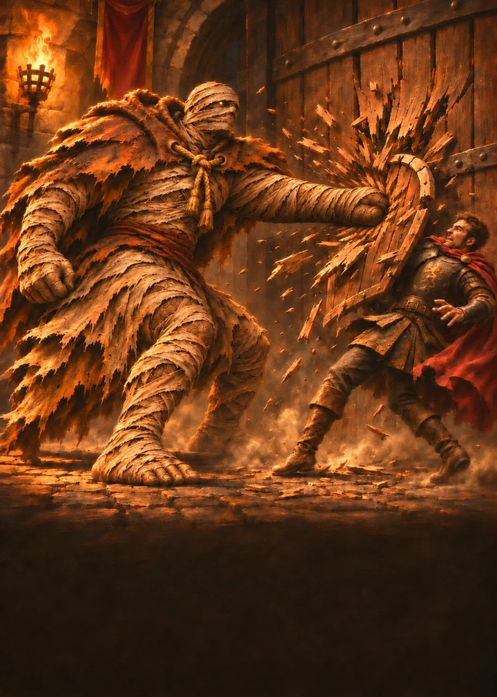

# Marrow Rite

A brutal dark-fantasy tag-team fighting card game (TCG). Every hundred years Vorhul, the Unburied, holds a tournament to choose who sits beside his throne. The losers become the throne.

Build a team of three fighters, tag between them, and play your cards like combos.

**Play it:** open the project's GitHub Pages site and press **Play now**. The site's address is shown in the repo's About box.

## The fighters

| Fighter | Title | Style | HP | Passive |
|---|---|---|---|---|
| Ashkar | The Ember Monk | Self-burn aggro | 29 | **Pyre:** first hit each turn applies Burn 2; builds Heat (max 5) |
| Sable Moru | The Stitched Surgeon | Bleed attrition | 27 | **Sutures:** heals 2 whenever an enemy takes Bleed damage |
| Brannoch | The Wrapped | Retaliation tank | 31 | **Grave Linen:** 2 Guard each turn; hits on his Guard take 1 back |
| Lady Wen | Of the Hollow | Discard engine | 24 | **Hunger:** discards build Hunger; Specials +1 per 2 Hunger |
| Old Teeth | The Bog Mother | Traps & venom control | 28 | **Patience:** unspent Energy becomes Guard; sets hidden Traps |
| Bram Coil | The Hook | Tag control & executions | 28 | **Reel:** 3 damage on tag-in; Noose amplifies every hit |
| Vorhul | The Unburied (boss) | Tithe & drain | 40 | **Tithe:** heals 6 whenever an enemy fighter is knocked out |

94 cards in total: 10 per fighter, 7 for Vorhul, 27 neutral, plus one Echo card per fighter.

### Starter decks

- **Plague Pyre** (Sable Moru, Ashkar, Old Teeth): stack Burn, Bleed and Venom, then cash them in.
- **The Gate Holds** (Brannoch, Old Teeth, Bram Coil): a wall of Guard that punishes attackers.
- **Thousand Cuts** (Bram Coil, Lady Wen, Ashkar): multi-hit attacks with per-hit bonuses.

Balance was checked with about 9,500 simulated games. Every card wins 47–56% of the games it appears in, and the starters sit at about 49% / 53% / 49% against each other.

## What's in this repo

| Path | What it is |
|---|---|
| `index.html` | The project landing page (served by GitHub Pages) |
| `play/` | The playable browser build: vs AI, packs, collection, deck builder. Progress saves in the browser. |
| `host/` | The Windows host app for 1v1 against friends (see `host/README.md`) |
| `marrow-rite-host.zip` | The same host app, zipped for download from the site |
| `art-prompts/` | Art bible and per-card image prompts, one file per fighter |
| `assets/` | Fighter portraits and finished card art used by the landing page |

## 1v1 multiplayer

GitHub Pages only serves static files, so online 1v1 isn't on the site itself. To play a friend, download `marrow-rite-host.zip`, unzip it on a Windows PC and double-click **Start Marrow Rite server.bat**. `host/README.md` has the full instructions, including how to let friends outside your Wi-Fi connect.

## Status

Concept build. The art is in progress: six fighter portraits and two card illustrations are finished, and the rest of the cards use placeholder frames.

All characters, story and art are original to this project.
